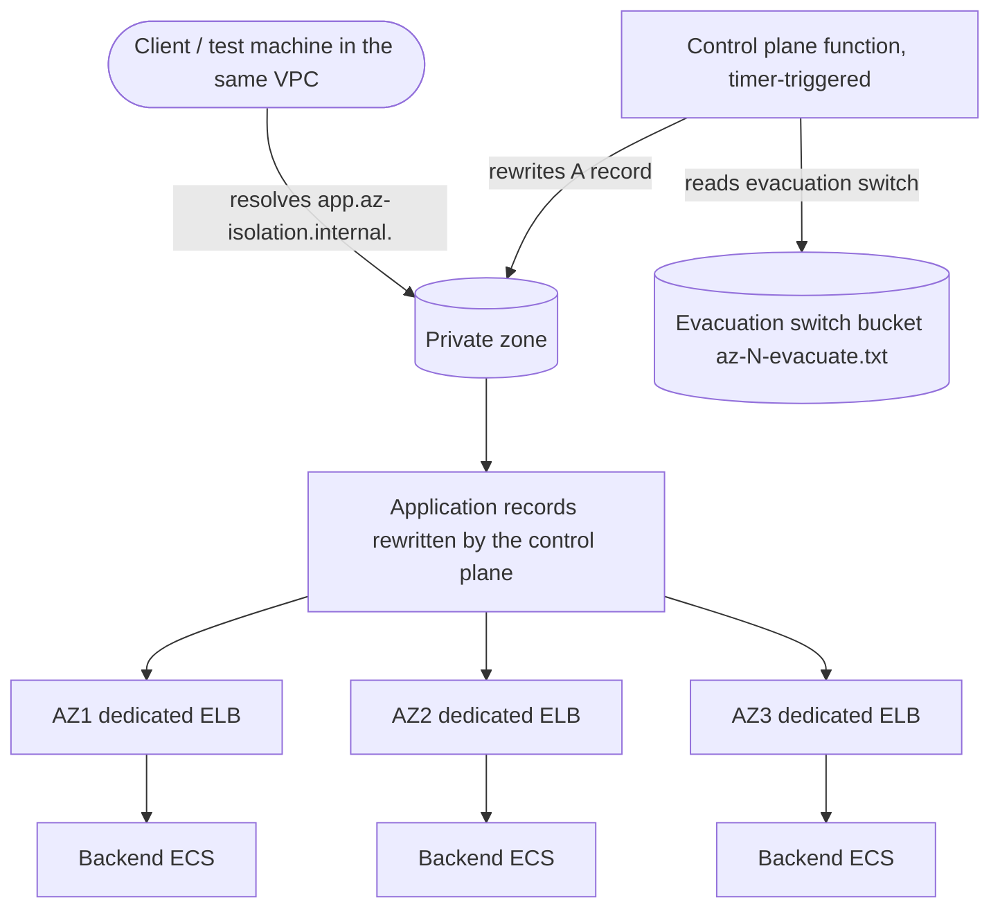

# deterministic-operations-az-traffic-isolation


## 1. Overview

### Introduction

A best practice implemented on Huawei Cloud for **manually evacuating traffic by availability zone**: when an availability zone becomes abnormal, a single command (placing or deleting a file in an Object Storage Service bucket) moves all traffic out of that zone, and a single command adds it back during recovery, **without modifying infrastructure code or restarting any instance**.

Target audience: architects and operations teams that need to keep availability-zone-level fault isolation at the business layer, and teams that want to separate the "traffic scheduling switch" from the infrastructure and place it under a runtime control plane.

---

## 2. Table of Contents

- [1. Overview](#1-overview)
- [2. Table of Contents](#2-table-of-contents)
- [3. Architecture Diagram](#3-architecture-diagram)
- [4. Highlights](#4-highlights)
- [5. Cloud Services Used](#5-cloud-services-used)
- [6. Prerequisites](#6-prerequisites)
- [7. Quick Start](#7-quick-start)
- [8. Step-by-Step Deployment](#8-step-by-step-deployment)
- [9. Usage / Verification](#9-usage--verification)
- [10. Cleanup](#10-cleanup)
- [11. Detailed Explanation](#11-detailed-explanation)
- [12. Dependencies](#12-dependencies)
- [13. FAQ / Troubleshooting](#13-faq--troubleshooting)
- [14. Contributing](#14-contributing)
- [15. License](#15-license)
- [16. Contact / Maintainers](#16-contact--maintainers)

---

## 3. Architecture Diagram



See [docs/architecture.md](docs/architecture.md) for the full description.

---

## 4. Highlights

- **Evacuation is a data action, not a configuration action**: place or delete a file; changes take effect within seconds and are reversible and auditable.
- **One load balancer per availability zone**: the fault domain and the evacuation unit coincide exactly; removing one load balancer means precisely evacuating one availability zone.
- **Reversed semantics + fail-open**: "the switch file exists" means failure, and being unable to read the switch naturally means everything is normal, which avoids cascading failures.
- **Own control plane**: the decision logic and failure behavior are fully readable, modifiable, and auditable.
- **No filing required for the internal-network form**: internal domain name plus internal dedicated load balancers allow complete verification without ICP filing.

---

## 5. Cloud Services Used

This practice uses the following Huawei Cloud services:

| Service | Purpose |
|---|---|
| VPC | Business subnets + load balancer subnets (one pair per AZ) |
| ECS (Elastic Cloud Server) | 3 backend servers + 1 test machine |
| Dedicated ELB (Elastic Load Balance) | One dedicated Layer-4 ELB per availability zone |
| DNS (Domain Name Service, private zone) | Internal application domain name resolution |
| OBS (Object Storage Service) | Evacuation switch bucket (az-N-evacuate.txt) |
| FunctionGraph | Control plane function |
| IAM (Agency) | Delegation for the control plane function |

---

## 6. Prerequisites

- Permission to create VPC, ECS, ELB, DNS, OBS, FunctionGraph, and IAM agencies.
- Terraform >= 1.5.0 and `huaweicloud` Provider >= 1.60.0.
- The elastic flavor `L4_flavor.elb.pro.max` exists in the target region (verify with the Provider data source).
- Provider credentials are provided through the environment variables `HW_ACCESS_KEY` / `HW_SECRET_KEY` / `HW_REGION_NAME`, or written to `~/.huaweicloudrc`; do not write them into code or into `.tf` configuration files.

---

## 7. Quick Start

```bash
cd infra
terraform init
terraform validate
terraform plan
terraform apply
```

---

## 8. Step-by-Step Deployment

1. `terraform init` — download the Provider.
2. `terraform validate` — check syntax and consistency.
3. `terraform plan` — preview the resources to be created.
4. `terraform apply` — create the resources.

For detailed steps, evacuation/recovery commands, and verification methods, see [docs/deployment-guide.md](docs/deployment-guide.md).

---

## 9. Usage / Verification

### Usage and Verification

Evacuate the second availability zone:

```bash
# Place the marker file (see the deployment guide for details; credentials shown as placeholders)
obsutil cp ./az-2-evacuate.txt obs://<BUCKET>/az-2-evacuate.txt

# Wait no more than 1 minute (timer trigger interval + DNS TTL)
sleep 75

# Poll the application entry point from the test machine; only 1 and 3 should remain
for i in $(seq 1 20); do
curl -s http://app.az-isolation.internal.:8080/ | python3 -c "import sys,json;print(json.load(sys.stdin)['az_suffix'])"
done
```

To recover: delete the marker file, wait no more than 1 minute, and 1/2/3 will appear again. For the complete verification script and console operations, see Section 4 of [docs/deployment-guide.md](docs/deployment-guide.md).

After deployment, follow these steps to verify that the business functionality works before considering the delivery complete.

---

## 10. Cleanup

```bash
cd infra
terraform destroy
```

A versioned bucket must have its versions and delete markers cleared before it can be destroyed. See Section 5 of the deployment guide.

---

## 11. Detailed Explanation

- **Core design**: one load balancer per availability zone, reversed semantics for the evacuation switch, control-plane fail-open, and full-evacuation fallback. See Section 3 of [docs/architecture.md](docs/architecture.md).
- **Evacuation/recovery flow**: see Section 5 of [docs/architecture.md](docs/architecture.md).
- **Configuration items**: all variables and their default values are in `infra/variables.tf` and `infra/terraform.tfvars.example`.

---

## 12. Dependencies

- Terraform and the `huaweicloud` Provider.
- The control plane function uses only the Python standard library and has no third-party dependencies.
- Backend server image: the public image `Ubuntu 22.04 server 64bit` (includes Python 3).

---

## 13. FAQ / Troubleshooting

### FAQ

**Q: I waited a long time after evacuation but the DNS records did not change?**
A: Convergence is limited by the minimum timer trigger interval (1 minute) plus the DNS TTL (5 seconds by default), so it takes up to about 60–70 seconds. Confirm that the marker file name matches the `evacuation_keys` output.

**Q: What happens if all three availability zones are evacuated at the same time?**
A: The control plane refuses to clear the DNS records (a complete service outage is worse than a single-AZ failure), keeps the current state, and leaves the decision to a human.

**Q: The control plane function returns 403 and cannot read the switch bucket?**
A: The OBS data plane does not recognize account-level roles attached to an agency; bucket policy authorization is required (already built in). If you changed the agency permissions, clear the function instances to force a cold start.

**Q: Changing the timer trigger interval has no effect?**
A: An ACTIVE TIMER trigger cannot be updated in place and is already covered by `ignore_changes`; use `terraform taint` to recreate the trigger.

**Q: The function returns 403 when writing DNS records (`DNS.1802 No permissions for any one of the roles: [dns_adm, ...]`)?**
A: The agency role was placed in the wrong scope. Huawei Cloud roles come in two kinds: `AX` (global service level, placed in `domain_roles`) and `XA` (project level, placed in `project_role`). `DNS Administrator` belongs to `XA`; if it is put into `domain_roles`, the server accepts the request but the permission does not take effect. The default configuration handles this correctly; see the "Agency Authorization" section of the deployment guide. After changing permissions, run `terraform apply -replace=huaweicloud_fgs_function.controller` to cold-start the function.

**Q: `terraform plan` always shows a diff for an agency that cannot be eliminated?**
A: `op_svc_cff` is a cloud service delegate; when read back by the server it lands in `delegated_service_name`. If the configuration uses `delegated_domain_name` instead, a permanent diff results. This repository uses the former.

---

## 14. Contributing

Improvements are welcome through Issues / Pull Requests.

---

## 15. License

This practice is licensed under **MIT No Attribution**; see the [`LICENSE`](LICENSE) file in the repository root.

This project is open sourced under the MIT License. See [LICENSE](LICENSE).

---

## 16. Contact / Maintainers
| Item | Content |
|---|---|
| **Creator** | [dgc-git](https://github.com/dgc-git) |
| **Maintainer** | [dgc-git](https://github.com/dgc-git) |
| **Contact** | GitHub Issues / PR (see [Section 14](#14-contributing)) |
