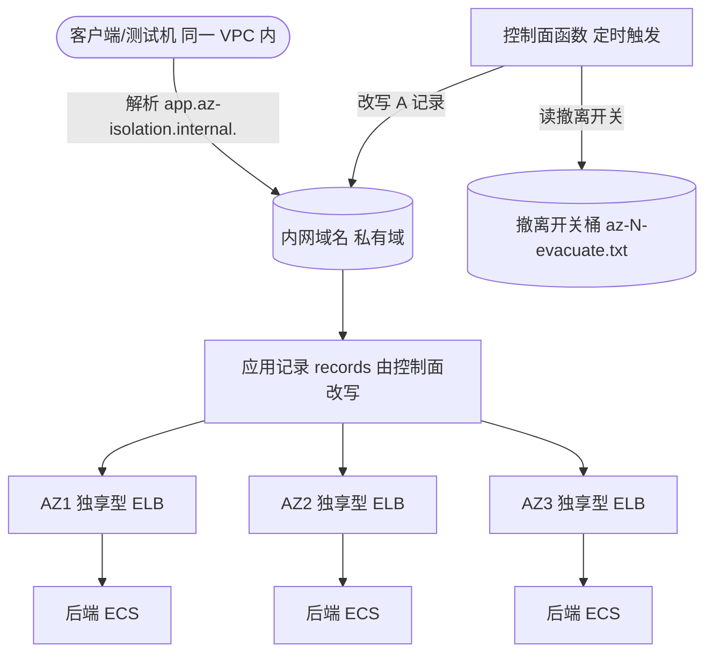

# deterministic-operations-az-traffic-isolation · 可用区隔离实践


## 1. 简介 / Overview

### 简介


一套在华为云上实现的**按可用区手动撤离流量**最佳实践：当某个可用区出现异常时，用一条命令（往对象存储桶放/删一个文件）把流量整体移出该可用区，恢复时同样一条命令加回，**全程不修改基础设施代码、不重启实例**。

适用对象：需要在业务层保留可用区级故障隔离能力的架构师与运维团队；希望把「流量调度开关」从基础设施剥离、交给运行时控制面管理的团队。

---

## 2. 目录

- [1. 简介 / Overview](#1-简介--overview)
- [2. 目录](#2-目录)
- [3. 架构图](#3-架构图)
- [4. 方案亮点](#4-方案亮点)
- [5. 涉及云服务](#5-涉及云服务)
- [6. 前置条件](#6-前置条件)
- [7. 快速开始](#7-快速开始)
- [8. 分步部署](#8-分步部署)
- [9. 使用方法 / 验证](#9-使用方法--验证)
- [10. 清理资源](#10-清理资源)
- [11. 详细说明](#11-详细说明)
- [12. 依赖](#12-依赖)
- [13. FAQ / 故障排除](#13-faq--故障排除)
- [14. 贡献指南](#14-贡献指南)
- [15. 许可证](#15-许可证)
- [16. 联系方式 / 维护者](#16-联系方式--维护者)

---

## 3. 架构图



完整说明见 [docs/architecture.md](docs/architecture.md)。

---

## 4. 方案亮点

- **撤离是数据动作而非配置动作**：放/删一个文件即可，秒级可撤销、可审计。
- **每可用区一个负载均衡器**：故障域与撤离单元严格重合，摘一个负载均衡器 = 精确移出一个可用区。
- **反转语义 + fail-open**：开关文件「存在即故障」，读不到开关天然等同于一切正常，避免级联故障。
- **自有控制面**：判定逻辑与失败行为完全可读、可改、可审计。
- **内网形态零备案**：内网域名 + 内网独享型负载均衡，无需备案即可完整验证。

---

## 5. 涉及云服务

本实践使用以下华为云服务：

| 服务 | 用途 |
|---|---|
| VPC | 业务子网 + 负载均衡子网（每 AZ 一对） |
| ECS（弹性云服务器） | 3 台后端 + 1 台测试机 |
| 独享型 ELB（弹性负载均衡） | 每可用区一个独享型四层 ELB |
| 云解析 DNS（私有域） | 内网应用域名解析 |
| 对象存储 OBS | 撤离开关桶（az-N-evacuate.txt） |
| 函数工作流 FunctionGraph | 控制面函数 |
| IAM（Agency） | 控制面函数委托 |

---

## 6. 前置条件

- 具备 VPC、ECS、ELB、DNS、OBS、FunctionGraph、IAM 委托的创建权限。
- Terraform ≥ 1.5.0，`huaweicloud` Provider ≥ 1.60.0。
- 目标区域存在弹性规格 `L4_flavor.elb.pro.max`（用 Provider 数据源核验）。
- Provider 凭证通过环境变量 `HW_ACCESS_KEY` / `HW_SECRET_KEY` / `HW_REGION_NAME` 注入，或写入 `~/.huaweicloudrc`，**不写入代码或配置文件进 `.tf`**。

---

## 7. 快速开始

```bash
cd infra
terraform init
terraform validate
terraform plan
terraform apply
```

---

## 8. 分步部署

1. `terraform init` —— 下载 Provider。
2. `terraform validate` —— 语法与一致性校验。
3. `terraform plan` —— 预览将创建的资源。
4. `terraform apply` —— 创建资源。

详细步骤、撤离/恢复命令与验证方法见 [docs/deployment-guide.md](docs/deployment-guide.md)。

---

## 9. 使用方法 / 验证

### 使用方法与验证


撤离第 2 个可用区：

```bash
# 放标记文件（详情见部署指导书，凭据以占位符表示）
obsutil cp ./az-2-evacuate.txt obs://<BUCKET>/az-2-evacuate.txt

# 等待 ≤ 1 分钟（定时触发周期 + 解析 TTL）
sleep 75

# 从测试机轮询应用入口，应只剩 1 和 3
for i in $(seq 1 20); do
curl -s http://app.az-isolation.internal.:8080/ | python3 -c "import sys,json;print(json.load(sys.stdin)['az_suffix'])"
done
```

恢复：删除标记文件，等待 ≤ 1 分钟，1/2/3 重新出现。完整验证脚本与控制台操作见 [docs/deployment-guide.md](docs/deployment-guide.md) 第 4 节。

部署完成后请按本节步骤自行验证，确认业务功能可用，方可视为交付完成。

---

## 10. 清理资源

```bash
cd infra
terraform destroy
```

版本化桶需先清空版本与删除标记再销毁。详见部署指导书第 5 节。

---

## 11. 详细说明

- **核心设计**：每可用区一个负载均衡器、撤离开关反转语义、控制面 fail-open 与全撤离兜底。见 [docs/architecture.md](docs/architecture.md) 第 3 节。
- **撤离/恢复流程**：见 [docs/architecture.md](docs/architecture.md) 第 5 节。
- **配置项**：全部变量及默认值见 `infra/variables.tf` 与 `infra/terraform.tfvars.example`。

---

## 12. 依赖

- Terraform 与 `huaweicloud` Provider。
- 控制面函数仅使用 Python 标准库，无第三方依赖。
- 后端服务镜像：`Ubuntu 22.04 server 64bit` 公共镜像（自带 Python 3）。

---

## 13. FAQ / 故障排除

### FAQ


**Q：撤离后等了很久解析没变？**
A：收敛时间受定时触发器最小粒度（1 分钟）+ 解析 TTL（默认 5 秒）限制，最长约 60–70 秒。确认标记文件名与 `evacuation_keys` 输出一致。

**Q：三个可用区同时撤离会发生什么？**
A：控制面拒绝把解析清空（彻底断服比单 AZ 故障更严重），维持原样并暴露给人判断。

**Q：控制面函数报 403 读不到开关桶？**
A：对象存储数据面不认委托挂的账号级角色，必须靠桶策略授权（已内置）。若改过委托权限，需清理函数实例冷启动。

**Q：修改了定时触发器周期不生效？**
A：ACTIVE 状态的 TIMER 触发器拒绝原地更新，已 `ignore_changes`；需 `terraform taint` 重建触发器。

**Q：函数写解析记录报 403（`DNS.1802 No permissions for any one of the roles: [dns_adm, ...]`）？**
A：委托角色放错了作用域。华为云角色分 `AX`（全局服务级，放 `domain_roles`）与 `XA`（项目级，放 `project_role`）两类，`DNS Administrator` 属于 `XA`，塞进 `domain_roles` 时服务端接受请求但权限不生效。默认配置已分开处理，详见部署指导书「委托授权」一节。改完权限须 `terraform apply -replace=huaweicloud_fgs_function.controller` 冷启动函数。

**Q：`terraform plan` 总有一条委托的差异消不掉？**
A：`op_svc_cff` 属于云服务委托方，服务端读回时落在 `delegated_service_name`；配置里若写成 `delegated_domain_name` 就会产生永久性差异。本仓库已使用前者。

---

## 14. 贡献指南

欢迎通过 Issue / Pull Request 提出改进。

---

## 15. 许可证

本实践采用 **MIT No Attribution** 许可证，详见仓库根目录 [`LICENSE`](LICENSE) 文件。


本项目以 MIT 许可证开源。详见 [LICENSE](LICENSE)。

---

## 16. 联系方式 / 维护者
| 项 | 内容 |
|---|---|
| **创建者** | [dgc-git](https://github.com/dgc-git) |
| **维护者** | [dgc-git](https://github.com/dgc-git) |
| **联系方式** | GitHub Issues / PR（见[第 14 节](#14-贡献指南)） |
