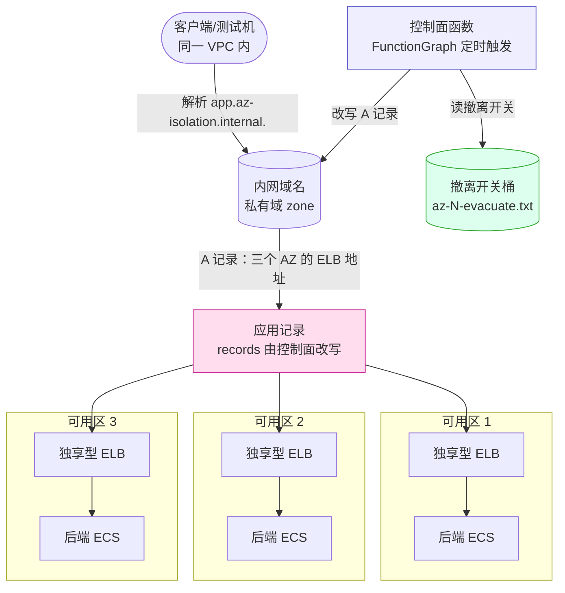
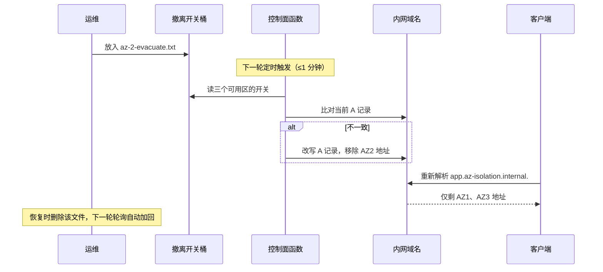

# 可用区隔离实践 · 架构说明

> 本文描述一套「按可用区手动撤离流量」的最佳实践，所有组件均为华为云原生产品。

## 1. 概述

本实践解决一个非常具体的问题：**当某个可用区出现非致命异常（如实例批量抖动、底层网络劣化）时，用一条命令把流量整体移出该可用区，并在恢复后同样用一条命令让它回到服务中——全程不修改基础设施代码，也不重启任何实例。**

它面向两类读者：

- 需要在业务层保留「可用区级故障隔离」能力的架构师与运维；
- 希望把「流量调度开关」从基础设施里剥离出来、交给运行时控制面管理的团队。

核心收益：可用区撤离变成一个**数据动作**（往对象存储桶里放/删一个文件），而不是一个**配置动作**（改 IaC 再 apply）。前者秒级可撤销、可审计、不影响其他资源。

## 2. 架构总览

入口只有一条内网域名 `app.az-isolation.internal.`。客户端解析后拿到三个可用区负载均衡器的地址并轮询；撤离某个可用区，就是把它的地址从这个列表里拿掉。

## 3. 核心设计

### 3.1 每个可用区一个负载均衡器（隔离的根本）

整套实践成立与否，取决于一个约束：**每个负载均衡器只落在一个可用区里**，后端池里也只放同一个可用区的那一台服务器。故障域与撤离单元因此严格重合——把某个负载均衡器从解析里摘掉，就精确等于移出那一个可用区。

负载均衡器的可用区归属由 `availability_zone` 直接决定，语义由拓扑本身保证。

### 3.2 撤离开关的「反转语义」

开关放在一个对象存储桶里，并且语义是**反的**：

| 桶里有没有 `az-N-evacuate.txt` | 含义 |
| --- | --- |
| 有 | 第 N 个可用区已撤离 |
| 没有（默认） | 第 N 个可用区正常服务 |

之所以用「存在即故障」而不是「存在即健康」，是为了让**读不到开关这件事天然等价于一切正常**：开关本身（对象存储）出问题时，不会连锁把整个服务判死。这就是 fail-open 设计，也是这套方案里最值得保留的一点。

### 3.3 控制面：判定与执行都收敛在一处

内网域名服务本身不具备「按外部开关自动选路」的能力，因此本实践显式建一个自有控制面：一个定时函数读撤离开关，把结论写进解析记录。好处是判定逻辑、反转语义、失败时的行为全部握在自己手里，可读、可改、可审计。

控制面严格遵守三条规则：

1. **探测不到某个可用区的开关状态时，按「未撤离」处理**（fail_open 为 true 时）；只读不到开关不会误伤正常可用区。
2. **三个可用区被全部撤离时，不清空解析记录**，而是维持原样——把域名解析成空集合是彻底断服，比任何一个可用区故障都严重，应暴露给人来判断。
3. **解析结果与目标一致时不发起写操作**，避免无谓的接口调用与变更记录（幂等）。

### 3.4 收敛时间

定时触发器最小粒度是 1 分钟，这也是本实践收敛时间（约 60–70 秒）的主要来源：写开关后，下一轮轮询才会把它落到解析里。配合解析记录的短 TTL（默认 5 秒），客户端在轮询触发后很快就能感知到变化。

## 4. 组件说明

| 组件 | 华为云服务 | 说明 |
| --- | --- | --- |
| 网络 | 虚拟私有云 VPC + 每可用区一对子网 | 每个可用区一个负载均衡子网 + 一个后端子网，按可用区切分是隔离的地基 |
| 后端 | 弹性云服务器 ECS | 每可用区一台，跑只用标准库写的 HTTP 服务，响应里带回可用区编号 |
| 负载均衡 | 独享型弹性负载均衡 ELB | 每可用区一个，`availability_zone` 只填一个值，使用四层弹性规格 |
| 入口 | 云解析服务 DNS 私有域 | 内网域名，仅关联 VPC 内可解析，无需备案；应用记录 `records` 由控制面改写 |
| 开关 | 对象存储服务 OBS 桶 | 撤离开关的唯一真相源；默认私有，靠桶策略显式授权控制面读取 |
| 控制面 | 函数工作流 FunctionGraph | 定时读开关、改写解析记录；绑定委托，运行时下发临时凭证，无长期密钥 |
| 验证 | 测试机 ECS | 内网域名只在 VPC 内可解析，需一台同网段机器发起验证 |

## 5. 撤离与恢复流程

撤离 = 放文件；恢复 = 删文件。两者都不碰基础设施代码。

## 6. 涉及云服务

| 服务 | 用途 |
| --- | --- |
| VPC | 业务子网 + 负载均衡子网（每 AZ 一对） |
| ECS（弹性云服务器） | 3 台后端 + 1 台测试机 |
| 独享型 ELB（弹性负载均衡） | 每可用区一个独享型四层 ELB |
| 云解析 DNS（私有域） | 内网应用域名解析 |
| 对象存储 OBS | 撤离开关桶（az-N-evacuate.txt） |
| 函数工作流 FunctionGraph | 控制面函数（按需读开关 + 改写解析） |
| IAM（Agency） | 控制面函数委托 |

## 7. 限制与残留风险

- **收敛时间约 60–70 秒**：受定时触发器最小粒度限制，无法做到秒级。若要求更快，需要改用事件驱动（如对象上传事件触发函数），会额外引入消息通知服务。
- **全撤离兜底为「不动作」**：三个可用区同时被标记撤离时，解析维持原样。这是有意为之，但意味着此时需要人介入判断，而非自动选路。
- **控制面自身故障**：若函数或委托失效，解析记录不会被更新，但也不会被错误改写；最坏情况是撤离动作延迟到控制面恢复。
- **对象存储桶策略是读开关的唯一授权途径**：华为云对象存储数据面不认委托挂的账号级角色，必须配桶策略（已内置）。改委托权限后需清理函数实例冷启动。
- **销毁版本化桶的已知坑**：若开启 `enable_switch_bucket_versioning`，`terraform destroy` 可能因批量删对象失败而残留，清理方法详见部署指导书。
